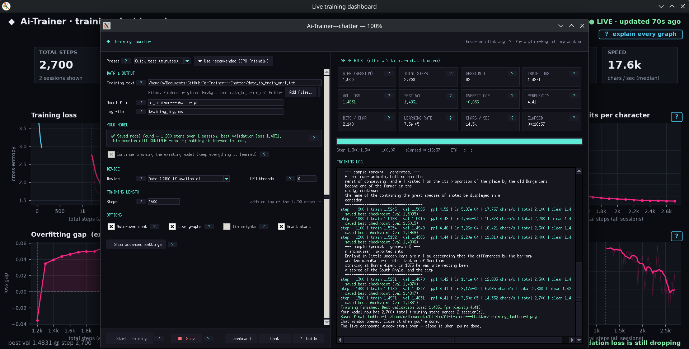
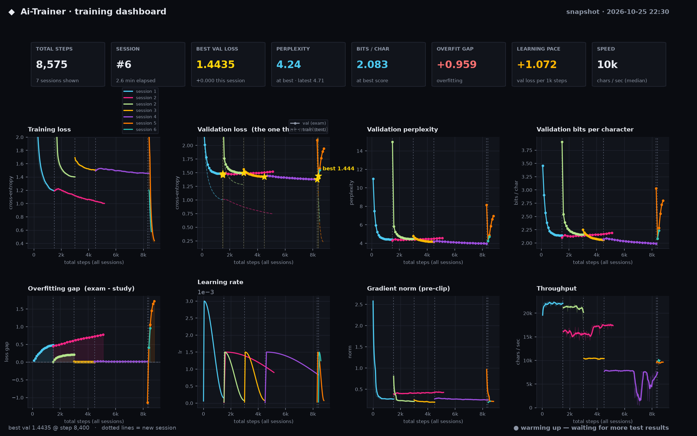
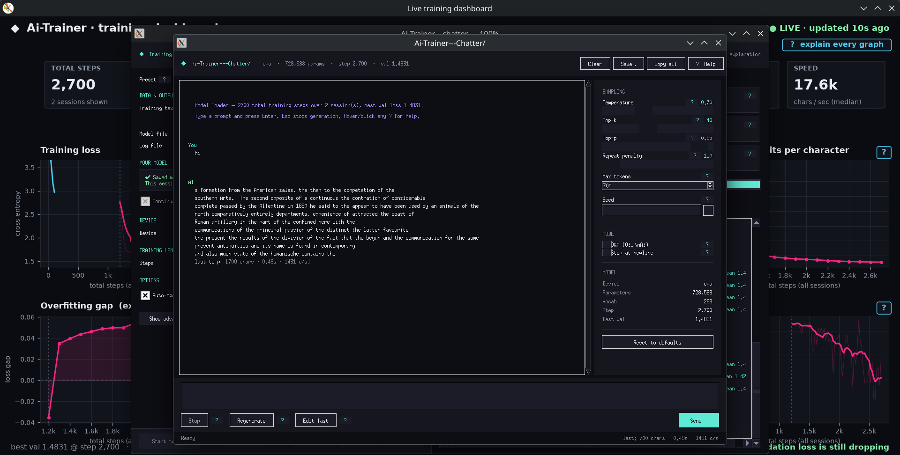
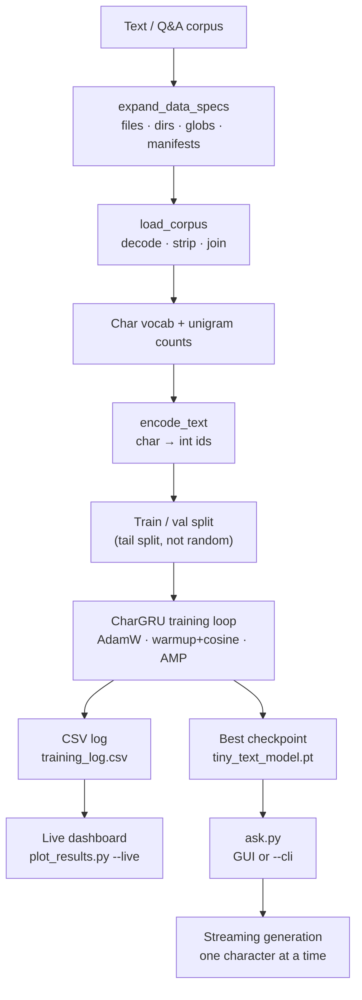

# 🧠 AI Trainer & Chatter

**Train a character-level GRU on your own text files, watch training happen live, and chat with the result through a streaming GUI or a terminal REPL.**

[](https://www.python.org/)
[](https://pytorch.org/)
[](#-features)
[](#-installation)
[](./LICENSE)
[](#-understanding-the-model)

[](https://github.com/Mourad-Abidi/Ai-Trainer---Chatter/stargazers)
[](https://github.com/Mourad-Abidi/Ai-Trainer---Chatter/network/members)
[](https://github.com/Mourad-Abidi/Ai-Trainer---Chatter/issues)
[](https://github.com/Mourad-Abidi/Ai-Trainer---Chatter/pulls)
[](https://github.com/Mourad-Abidi/Ai-Trainer---Chatter/commits)

AI Trainer & Chatter is an experimental Python project that makes it easy to train, monitor, and query a **character-level language model** on your own text data — no pretrained model, no tokenizer, no cloud. Everything runs locally on PyTorch.

The project bundles:

- a **character-level GRU** (`CharGRU`) with LayerNorm, weight tying, and unigram-prior output-bias initialization,
- a **training launcher** with both a rich Tkinter GUI and a headless `--cli` mode,
- a **live training dashboard** built with matplotlib,
- a **streaming chat client** with a GUI chat window and a slash-command terminal REPL,
- a **synthetic Q&A data generator** for arithmetic.

---

## 📑 Table of Contents

- [Screenshots](#-screenshots)
- [Overview](#-overview)
- [Features](#-features)
- [How It Works](#️-how-it-works)
- [Project Structure](#-project-structure)
- [Requirements](#-requirements)
- [Installation](#-installation)
- [Quick Start](#-quick-start)
- [Preparing Your Training Data](#-preparing-your-training-data)
- [Training the Model](#️-training-the-model)
- [Monitoring Training](#-monitoring-training)
- [Chatting With the Trained Model](#-chatting-with-the-trained-model)
- [Generating Arithmetic Training Data](#-generating-arithmetic-training-data)
- [Understanding the Model](#-understanding-the-model)
- [Hyperparameters Reference](#️-hyperparameters-reference)
- [The Loss-Reduction Playbook](#-the-loss-reduction-playbook)
- [Troubleshooting](#-troubleshooting)
- [Contributing](#-contributing)
- [Roadmap](#️-roadmap)
- [License](#-license)

---

## 📸 Screenshots

A quick tour of the three screens you will use most. All three ship with the project and run locally — no browser, no cloud.

### Training Launcher



*`python train.py` — pick your text, choose a preset, tweak any hyperparameter (every field has a `?` help badge), and watch live metrics while the model trains.*

### Live Training Dashboard



*`python plot_results.py --live` (opened automatically by `train.py`) — training and validation loss, perplexity, bits per character, generalisation gap, learning rate, gradient norm and throughput, updated while training runs.*

### Chat Window



*`python ask.py` — token-by-token streaming, adjustable sampling (temperature, top-k, seed), Q&A mode, and a model card showing the loaded checkpoint.*

| Screen | Script | Command | Terminal alternative |
|---|---|---|---|
| Training Launcher | `train.py` | `python train.py` | `python train.py --cli` |
| Live Training Dashboard | `plot_results.py` | `python plot_results.py --live` | `python plot_results.py` (saves a PNG) |
| Chat Window | `ask.py` | `python ask.py` | `python ask.py --cli` |

> **Contributors:** if you change any of these screens, please refresh the matching image in [`Pics/`](./Pics) — see [CONTRIBUTING.md](./CONTRIBUTING.md#-ui-reference-and-screenshots).

---

## 🌟 Overview

AI Trainer & Chatter is organised around four concrete activities:

| Activity | Script | Entry point |
|---|---|---|
| **Train** the model | `train.py` | GUI by default; `--cli` for headless |
| **Monitor** training | `plot_results.py` | Auto-launched live window; PNG on completion |
| **Chat** with the model | `ask.py` | GUI by default; `--cli` for terminal REPL |
| **Generate** synthetic data | `generate_data.py` | CLI only — arithmetic Q&A |

Everything is local. The model is a small (≈2M-parameter at default settings) multi-layer GRU trained one character at a time. It learns statistical patterns in the supplied corpus — it does **not** acquire reasoning, facts, or conversational abilities.

### 🎯 Goals

- Train a language model end-to-end on your own text, on CPU or one GPU.
- Provide an honest visualization of the training process (8 panels, per run).
- Ship a smooth, streaming chat experience for tiny models.
- Stay fully reproducible: fixed seeds, CSV logs, checkpointed metadata.

### 👥 Who this is for

- Students learning the mechanics of language models.
- PyTorch users who want a small, complete project to explore.
- Anyone training a tiny model on a domain-specific text corpus.

---

## ✨ Features

### 🧠 Character-level GRU (`model.py`)

The `CharGRU` model is deliberately simple but well-engineered:

- **Multi-layer GRU** with `batch_first=True`.
- **LayerNorm** applied before the output projection — this stabilizes higher learning rates.
- **Three dropout points**: on the embedding output, between GRU layers (only when `num_layers > 1`), and before the classifier.
- **Weight tying** (`--tie-weights`): shares input embedding and output projection. Saves parameters *and* regularizes. Requires `embedding_dim == hidden_size`.
- **Unigram-prior output-bias init** (`--no-unigram-bias-init` to disable): seeds the output bias with `log p(char)` from the corpus so step 0 already predicts characters at the right frequency. Free warmup savings.
- **Orthogonal init** on the GRU recurrent weights, **Xavier** on the input weights — the standard Zaremba et al. (2014) recipe.
- **Streaming generator** (`generate_tokens`) and batched generation (`generate`) that carry the hidden state forward, so each new token costs one GRU step.
- **`from_checkpoint`** loads a model + metadata + device in one call.

### 🏋️ Training (`train.py`)

The default entry point opens a **GUI training launcher** — every hyperparameter has a hover tooltip and a `?` badge. Prefer the terminal? Pass `--cli`.

> 📸 See the [Training Launcher screenshot](#training-launcher).

Key behaviors, straight from the code:

- **Data resolution** supports files, directories (walked recursively), and globs.
- **Large corpora**: use `--data-list manifest.txt` to dodge the OS argument-length limit. The GUI auto-writes a temporary manifest when the spec list exceeds 200 entries.
- **Auto-detect fallback**: with no `--data`, the loader picks up `1.txt … 10.txt` in the current directory.
- **AdamW** with `betas=(0.9, 0.95)` and **decoupled weight decay** on weights only (biases and LayerNorm excluded).
- **Warmup + cosine decay** schedule: `warmup_steps` linear ramp, then cosine decay to `peak × min_lr_ratio`.
- **Mixed precision** on CUDA (bfloat16 when supported, otherwise float16 with a `GradScaler`).
- **Gradient clipping** at max-norm 1.0.
- **Label smoothing** support (off by default — validation always reports plain cross-entropy).
- **Gradient accumulation** via `--grad-accum`.
- **Early stopping** via `--patience N` (evaluations without val improvement).
- **Best-checkpoint saving** whenever validation loss improves.
- **Live dashboard** auto-launched in a subprocess (`--no-live` to disable).
- **Auto-chat**: opens the chat window when training finishes (`--no-auto-chat` to disable).
- **Sample generation** printed every `--sample-every` evaluations for a sanity check.
- **Ctrl+C safe**: interrupts cleanly and preserves the best checkpoint.
- **Strict argument validation** — bad configs are rejected before any work starts.

### 📊 Training dashboard (`plot_results.py`)

A dark-themed, 8-panel matplotlib dashboard that updates while training runs.

> 📸 See the [dashboard screenshot](#live-training-dashboard).

| Panel | Metric |
|---|---|
| Training loss | Cross-entropy on train batches (raw + 8-point rolling mean) |
| Validation loss | Cross-entropy on held-out data, with best-marked star |
| Validation perplexity | `exp(val_loss)`, clipped at 20 |
| Validation bits/char | `val_loss / log(2)` |
| Generalisation gap | `val_loss − train_loss` |
| Learning rate | Cosine schedule trace |
| Gradient norm | Pre-clip L2 norm |
| Throughput | Characters per second |

- **Multi-run support**: pass `--run-id` to filter to one run; without it, plots overlay every run in the CSV, colour-coded.
- **`--live`**: opens a refreshable window (train.py does this automatically).
- **Default (no `--live`)**: writes `training_dashboard.png` from the current CSV.

### 💬 Chat (`ask.py`)

Two modes, same model:

> 📸 See the [chat window screenshot](#chat-window).

**GUI (default)** — a proper streaming chat window:

- Token-by-token rendering as the model generates.
- **Stop** (Esc), **Regenerate**, **Edit last**, **Clear** (Ctrl+L), **Save** (Ctrl+S to `.md` or `.json`), **Copy all**, **Help**.
- **Sampling sidebar**: temperature slider, top-k slider, max-tokens spinbox, seed field with a 🎲 random-seed button.
- **Mode toggles**: Q&A wrapper (`Q: …\nA:`) and stop-at-newline.
- **Right-click context menu** on the transcript.
- **Model card** in the sidebar: device, params, vocab, training step, best val loss.
- **Tooltips and `?` help badges** on every control.
- **Settings persist** to `~/.tiny_text_ai_ask.json` between sessions.
- **Falls back to CLI** automatically when no display is available.

**Terminal REPL (`--cli`)** — a full slash-command shell:

```
/help                 this message
/quit                 exit
/temp <f>             temperature (0 = greedy)
/topk <n>             top-k (0 = no filtering)
/max <n>              max new tokens
/qa on|off            Q&A mode
/stop_nl on|off       stop at newline
/seed <n|clear>       sampling seed
/save <path>          save transcript (.md or .json)
/clear                clear transcript
/stats                current sampling settings
/model                model card
```

Anything not starting with `/` is treated as a prompt. Streaming output, per-turn stats (chars · seconds · chars/s), graceful handling of out-of-vocabulary characters.

### 🛠️ Synthetic data (`generate_data.py`)

A focused utility that generates **arithmetic Q&A** examples for training a tiny model on structured patterns.

- Enumerates **all** combinations of `a` and `b` from 0 to `--max-number` for each chosen operator.
- Format: `Q: {a} {op} {b}\nA: {answer}\n`.
- Operators: `+`, `-`, `*`, `//` (integer division; division by zero is skipped).
- **Appends** to the output file when it already exists — you keep your old data.
- `--max-number` is clamped to 99 for full combinatorial coverage.

Example output:

```text
Q: 7 + 3
A: 10

Q: 12 * 8
A: 96

Q: 47 // 5
A: 9
```

---

## ⚙️ How It Works



### Step 1 — Resolve data specs

`expand_data_specs` walks directories recursively, expands globs, and de-duplicates. Extensions are filtered via `--data-ext` (default `.txt,.text,.md`). Missing specs are reported as a batch warning, not a fatal error.

### Step 2 — Load the corpus

`load_corpus` decodes each file with `--data-encoding` (default `utf-8`) and `--data-errors` (default `replace`). Undecodable bytes become `U+FFFD` and are reported as a warning count. Files are joined with `\n\n`.

> **Minimum corpus size:** 10,000 characters. Smaller datasets abort with a clear error.

### Step 3 — Build the vocabulary

The vocabulary is the union of all characters seen in the corpus and the built-in `BASE_CHARACTERS` (lowercase + uppercase + digits + space + common punctuation). Per-character counts are folded into a log-prior tensor for the output-bias init.

### Step 4 — Encode and split

Each character is mapped to an integer id. The split is a **tail split**: the last `val_fraction × len` characters become validation data. This is not a random mask — the two sets stay contiguous, which matches how the model is used at chat time.

### Step 5 — Train

Each step draws `batch_size` random windows of `block_size` characters. The model predicts the next character at every position. Loss is cross-entropy (optionally with label smoothing); gradients are accumulated `grad_accum` times, clipped at max-norm 1.0, then applied via AdamW. Validation runs every `eval_interval` steps, and the best checkpoint is saved whenever validation loss improves.

### Step 6 — Generate

`generate_tokens` yields one token id at a time with the hidden state carried forward. `temperature=0` selects the argmax; `top_k>0` restricts sampling to the k most likely candidates; a `should_stop` callback polls between tokens so the GUI Stop button interrupts cleanly.

---

## 📂 Project Structure

```text
Ai-Trainer---Chatter/
│
├── 1.txt … 10.txt           # Example training corpus (auto-detected)
├── model.py                 # CharGRU architecture + generation + checkpoint I/O
├── train.py                 # Training (GUI launcher + --cli headless mode)
├── ask.py                   # Chat (GUI window + --cli REPL)
├── plot_results.py          # Training dashboard (live window + static PNG)
├── generate_data.py         # Synthetic arithmetic Q&A generator
├── Pics/                    # Screenshots used by README.md and CONTRIBUTING.md
│   ├── Training_Launcher.png
│   ├── Training_DAshboard.png
│   └── Chat_DAshboard.png
├── README.md
├── CONTRIBUTING.md
└── LICENSE
```

### Generated artifacts (not committed)

| File | Created by | Purpose |
|---|---|---|
| `tiny_text_model.pt` | `train.py` | Best checkpoint (state dict + metadata) |
| `training_log.csv` | `train.py` | Per-step CSV log (rotated on schema change) |
| `training_dashboard.png` | `train.py`, `plot_results.py` | Saved dashboard PNG |
| `~/.tiny_text_ai_ask.json` | `ask.py` | Persisted sampling settings |

### File descriptions

| File | Purpose |
|---|---|
| `model.py` | Defines `CharGRU`, `generate()`, `generate_tokens()`, `from_checkpoint()`. |
| `train.py` | Data loading, validation, training loop, GUI launcher, CLI parser. |
| `ask.py` | Chat GUI (`ChatWindow`), CLI REPL (`run_cli`), settings persistence. |
| `plot_results.py` | `load_log`, `draw`, `save_static`, `run_live`. |
| `generate_data.py` | `generate_examples`, `calculate`, CLI entry. |
| `1.txt` – `10.txt` | Numbered example files, auto-detected by `train.py`. |
| `Pics/` | Screenshots of the launcher, dashboard and chat window (documentation only). |

---

## 💻 Requirements

| Dependency | Purpose | Required? |
|---|---|---|
| Python | 3.11 or 3.12 recommended | Yes |
| PyTorch | The model and training loop | Yes |
| NumPy | Fast encoding path in `train.py` | Recommended |
| Matplotlib | Live dashboard + static PNG | Yes (for `plot_results.py`) |
| Pandas | Reads `training_log.csv` | Yes (for `plot_results.py`) |
| Tkinter | Training launcher + chat window | Optional (CLI works without it) |

If Tkinter is missing, `train.py` and `ask.py` fall back to their `--cli` modes automatically.

---

## 🚀 Installation

### 1. Clone

```bash
git clone https://github.com/Mourad-Abidi/Ai-Trainer---Chatter.git
cd Ai-Trainer---Chatter
```

### 2. Virtual environment

**Linux / macOS:**

```bash
python3 -m venv .venv
source .venv/bin/activate
```

**Windows (PowerShell):**

```powershell
python -m venv .venv
.venv\Scripts\Activate.ps1
```

### 3. PyTorch

Install PyTorch for your OS and hardware using the official instructions:

<https://pytorch.org/get-started/locally/>

For a CPU-only install on Linux:

```bash
pip install torch --index-url https://download.pytorch.org/whl/cpu
```

### 4. Remaining dependencies

```bash
pip install numpy matplotlib pandas
```

### 5. Tkinter (optional, for the GUIs)

**Fedora:**

```bash
sudo dnf install python3-tkinter
```

**Debian / Ubuntu:**

```bash
sudo apt install python3-tk
```

**macOS / Windows:** Tkinter ships with the standard Python installer.

### 6. Verify

```bash
python -c "import torch, numpy; print('torch', torch.__version__)"
python -c "import matplotlib, pandas; print('plotting ready')"
python -c "import tkinter; print('tkinter ready')" || echo "(no tkinter — CLI only)"
```

---

## 🏁 Quick Start

The fastest path from zero to a chat with your own model:

```bash
# 1. Train a model on 1.txt..10.txt for 20k steps (default GUI)
python train.py

#   → GUI opens, every field pre-filled. Click "▶ Start training".
#   → The live dashboard opens in a separate window.
#   → When training finishes, the chat window opens automatically.

# 2. Chat with the resulting checkpoint
python ask.py
```

Prefer the terminal? Skip both GUIs:

```bash
python train.py --cli --no-live --no-auto-chat --steps 5000
python ask.py --cli
```

No corpus yet? Generate one:

```bash
python generate_data.py --max-number 50
python train.py --cli --data math_data.txt --steps 5000
```

---

## 📚 Preparing Your Training Data

### Supported sources

`train.py` combines three interchangeable sources:

| Flag | Accepts | Use when |
|---|---|---|
| `--data` | Files, directories, globs | Small/medium corpora |
| `--data-list` | A manifest file (one path per line) | 10k+ files or CI-friendly setups |
| *(nothing)* | Auto-detects `1.txt..10.txt` in CWD | Quick experiments |

### How specs are resolved

- **File** — added directly.
- **Directory** — walked recursively, picking up files whose extension matches `--data-ext`.
- **Glob** (contains `*?[`) — expanded with `glob.glob(..., recursive=True)`; directory matches are then walked.
- Duplicates are removed (by resolved absolute path).
- Files under any path component starting with `.` are skipped (`__pycache__`, `.git`, etc.).

### Manifest format

```text
# comments start with #
relative/paths/resolve/against/the/manifest.txt
/absolute/paths/are/fine/too.txt
../sibling_corpus/chapter_01.txt
```

A manifest is portable — its relative paths resolve against the manifest's own directory, not your CWD.

### What makes a good corpus

- 10,000+ characters minimum (hard requirement).
- Consistent formatting if you want structured output — e.g. `Q: …\nA: …` for the Q&A mode.
- UTF-8 encoded (or set `--data-encoding`).
- Relevant to what you want the model to do. A ~2M-param GRU saturates quickly; focus on quality and consistency, not size alone.

### Encodings and errors

- `--data-encoding utf-8` (default) — any codec Python recognises.
- `--data-errors replace` (default) — bad bytes become `U+FFFD` and a warning is printed.
- `--data-errors strict` — abort on the first decode error.
- `--data-errors ignore` — silently drop bad bytes.

---

## 🏋️ Training the Model

### Interface

```bash
# Default: open the GUI launcher
python train.py

# Headless training (required inside the GUI's spawned subprocess; also
# the mode you want in CI, ssh sessions, or scripts)
python train.py --cli

# GUI pre-filled with CLI arguments
python train.py --device cpu --steps 5000 --batch-size 64

# Headless with a specific GPU and thread count
python train.py --cli --device cuda:0 --num-threads 4 --steps 10000
```

> `--gui` is accepted for backwards compatibility and is a no-op. The default is already the GUI. `--cli` always wins if both are passed.

### Data

```bash
python train.py --cli --data corpus/                    # recursive walk
python train.py --cli --data notes.md other.txt         # explicit files
python train.py --cli --data "chapters/*.txt"           # glob
python train.py --cli --data-list manifests/big.txt     # 10k+ files
```

### Training loop, step by step

1. `expand_data_specs` resolves everything to a concrete file list.
2. `load_corpus` reads, decodes, strips, and joins with `\n\n`.
3. Vocab is built from `set(char_counts) | set(BASE_CHARACTERS)`.
4. Data is encoded with a NumPy fast path when NumPy is available.
5. The tail `val_fraction` of the text is held out for validation.
6. Each step:
   - Draws a random window batch.
   - Forward pass with autocast (bf16 on CUDA when supported).
   - Cross-entropy loss (with optional label smoothing).
   - `scaler.scale(loss / grad_accum).backward()`.
7. Every `eval_interval` steps, validation runs and the dashboard point is emitted.
8. Whenever validation loss improves, the best checkpoint is saved to `--checkpoint` (default `tiny_text_model.pt`).
9. On completion, `training_dashboard.png` is written and — unless `--no-auto-chat` — the chat window opens.

### Checkpoint contents

Each checkpoint is a `torch.save` dict with:

- `model_state_dict` (CPU-detached tensors)
- `characters` (the `itos` list)
- `block_size`, `embedding_dim`, `hidden_size`, `num_layers`, `dropout`, `tie_weights`
- `best_validation_loss`, `step`

`CharGRU.from_checkpoint` reads everything it needs — no external config required.

### Reading the training output

```
step   1000 | train 2.0145 | val 1.9832 | ppl 7.27 | lr 1.87e-03 | 3,412,290 chars/s
step   2000 | train 1.7723 | val 1.8102 | ppl 6.11 | lr 1.74e-03 | 3,398,104 chars/s
```

- **train / val**: cross-entropy (nats/char).
- **ppl**: `exp(val)` — how many characters the model is "choosing between" per step.
- **Random-guess baseline**: `ln(vocab)`. For the default ~72-char vocab that's ≈ 4.28. Your first eval should be far below that thanks to the unigram prior.
- **chars/s**: throughput — depends on device, block size, and batch size.

---

## 📊 Monitoring Training

`train.py` opens the live dashboard automatically (subprocess). Disable with `--no-live`.

### Standalone use

```bash
# Refreshable window (uses matplotlib's GUI backend)
python plot_results.py --live

# Static PNG from the current CSV
python plot_results.py --out dashboard.png

# Single run only
python plot_results.py --run-id a1b2c3d4

# Live + keep the PNG refreshed too
python plot_results.py --live --save-png
```

### Interpreting the panels

| Pattern | Interpretation |
|---|---|
| Train loss decreasing smoothly | The model is fitting. |
| Validation loss tracks train closely | Good generalization. |
| Validation loss rises while train falls | Overfitting — add data, dropout, weight decay. |
| Both plateau early | Not enough data, or LR schedule too short. |
| Gradient norm spikes then recovers | Minor instability — usually fine. |
| Gradient norm stays at the clip | LR too high for this model size. |
| Throughput collapsing over time | Memory pressure or a background process. |

The **best val loss** star on the validation panel marks the step where the saved checkpoint came from. That's the number to quote.

---

## 💬 Chatting With the Trained Model

### GUI (default)

```bash
python ask.py
```

- Type a prompt, press **Enter** to send.
- **Shift+Enter** inserts a newline.
- **Esc** stops generation.
- **Ctrl+L** clears the transcript, **Ctrl+S** saves it.
- **Regenerate** re-runs the last prompt with fresh sampling.
- **Edit last** pulls the last prompt back into the input field.
- Every control has a hover tooltip. Click **?** for the full reference.

### Terminal REPL

```bash
python ask.py --cli
```

Inside, type `/help` to see the slash commands. Anything else is treated as a prompt.

### Sampling controls

| Control | Default | Effect |
|---|---:|---|
| Temperature | 0.7 | 0 = greedy, 0.7 = balanced, 1.2+ = wild |
| Top-k | 40 | Sample only from the k most likely next characters; 0 disables |
| Max tokens | 200 | Hard cap on generated characters |
| Seed | *(empty)* | Empty = fresh randomness each time; set an int for reproducibility |
| Q&A mode | off | Wraps your prompt as `Q: …\nA:` and stops at the first newline |
| Stop at newline | off | Stop at first newline without changing the prompt format |

### Why the responses look odd

Small character-level GRUs:

- Misspell words.
- Drift off topic after ~50–100 characters.
- Repeat common patterns from the training data.
- Respond to facts they never learned.

This is expected. The model learns character statistics, not meaning. If the responses are *pure noise*, the model is undertrained (check val loss) or you're sampling at too high a temperature.

### Persisted settings

`~/.tiny_text_ai_ask.json` stores the last GUI settings. Delete it or pass `--no-settings` to reset.

### CLI-only overrides

```bash
python ask.py --cli --temperature 0.5 --top-k 20 --max-new-tokens 120
```

---

## 🧮 Generating Arithmetic Training Data

`generate_data.py` is a focused utility for producing **structured Q&A** examples — useful for sanity-checking that the model can learn a formulaic task.

```bash
# Default: all four operators, operands 0..99, all combinations
python generate_data.py

# Smaller range
python generate_data.py --max-number 20

# Subset of operators
python generate_data.py --operators + -

# Custom output file
python generate_data.py --output math_small.txt --max-number 15
```

- Output format: `Q: {a} {op} {b}\nA: {answer}\n\n` per example.
- **Appends** to the output file when it already exists.
- `--max-number` is clamped to 99 for full combinatorial coverage.
- Integer division (`//`) skips `b == 0`.

A representative output:

```text
Q: 3 + 4
A: 7

Q: 9 * 6
A: 54

Q: 27 // 4
A: 6
```

Then train:

```bash
python train.py --cli --data math_data.txt --steps 5000 --qa 2>/dev/null
python ask.py --cli --qa
```

Q&A mode wraps your terminal input as `Q: <you>\nA:` and stops at the first newline — matching the training format exactly.

---

## 🧩 Understanding the Model

`CharGRU` in `model.py` is ~2M parameters at the default settings. That is small on purpose.

### What a GRU does

A **Gated Recurrent Unit** processes a sequence one element at a time, maintaining a hidden state that carries information forward. Two gates — update and reset — control how much of the previous state to keep and how much of the new input to incorporate. The result is a network that can learn dependencies across tens or hundreds of characters without the vanishing-gradient issues of a vanilla RNN.

### What "character-level" means

Each token is a single character. The model sees a window of `block_size` characters (default 256) and is trained to predict the next character at every position. At generation time, one character is predicted, appended to the sequence, and fed back in.

### Design choices that matter

- **LayerNorm before the classifier** — dramatically stabilizes higher learning rates. Without it, warmup needs to be much longer.
- **Orthogonal init on recurrent weights** — the standard recipe; makes the first few thousand steps much less bumpy.
- **Unigram bias init** — the model starts at the right character frequencies. Big early-loss win, especially on short training runs.
- **Weight tying** — when `embedding_dim == hidden_size`, sharing the input and output matrices saves parameters and acts as a regularizer.

### Checkpoint metadata

Every checkpoint stores enough to reconstruct the model:

```python
model, ckpt, device = CharGRU.from_checkpoint("tiny_text_model.pt")
# ckpt keys: model_state_dict, characters, block_size, embedding_dim,
#            hidden_size, num_layers, dropout, tie_weights,
#            best_validation_loss, step
```

---

## ⚙️ Hyperparameters Reference

All defaults shown are what you get if you pass nothing. Every flag works identically in the CLI and (pre-filled) in the GUI.

### Data

| Flag | Default | Meaning |
|---|---|---|
| `--data` | auto-detect | Files, directories, or globs. |
| `--data-list` | *(none)* | Manifest file, one path per line. Repeatable. |
| `--data-ext` | `.txt,.text,.md` | Extensions picked up when walking directories/globs. Empty = any. |
| `--data-encoding` | `utf-8` | Any Python codec. |
| `--data-errors` | `replace` | `strict` · `replace` · `ignore`. |
| `--data-shuffle` | off | Shuffle file order (seeded by `--seed`). |

### Training schedule

| Flag | Default | Meaning |
|---|---:|---|
| `--steps` | 20000 | Total optimiser steps. |
| `--batch-size` | 128 | Sequences per step. |
| `--block-size` | 256 | BPTT window length. |
| `--learning-rate` | 2e-3 | Peak LR. |
| `--min-lr-ratio` | 0.05 | Final LR = peak × this. |
| `--warmup-steps` | 200 | Linear warmup. |
| `--weight-decay` | 0.01 | AdamW L2 on weight matrices only. |
| `--label-smoothing` | 0.0 | Training-time label smoothing. |
| `--grad-accum` | 1 | Micro-batches per optimiser step. |

### Architecture

| Flag | Default | Meaning |
|---|---:|---|
| `--embedding-dim` | 64 | Character embedding size. |
| `--hidden-size` | 512 | GRU hidden state size. |
| `--num-layers` | 2 | GRU depth. |
| `--dropout` | 0.1 | Applied in three places (see `model.py`). |
| `--tie-weights` | off | Share embedding and output weights. Requires `embedding_dim == hidden_size`. |
| `--unigram-bias-init` | **on** | Seed output bias with `log p(char)`. `--no-unigram-bias-init` to disable. |

### Validation & checkpointing

| Flag | Default | Meaning |
|---|---:|---|
| `--val-fraction` | 0.05 | Tail fraction of the corpus held out. |
| `--eval-interval` | 250 | Steps between evaluations. |
| `--eval-batches` | 20 | Validation batches per evaluation. |
| `--log-interval` | 25 | Steps between CSV log rows. |
| `--sample-every` | 4 | Print a generated sample every N evaluations. 0 = off. |
| `--patience` | 0 | Early-stop after N non-improving evals. 0 = off. |
| `--checkpoint` | `tiny_text_model.pt` | Where to save the best model. |
| `--log` | `training_log.csv` | CSV log path (auto-rotated if the schema changes). |
| `--run-id` | *(UUID8)* | Tags the run in the CSV so multi-run plots distinguish them. |
| `--seed` | 42 | Master RNG seed. |

### Runtime

| Flag | Default | Meaning |
|---|---|---|
| `--device` | `auto` | `auto` · `cpu` · `cuda:N`. |
| `--num-threads` | 0 | Torch CPU threads. 0 = let Torch choose. |
| `--no-live` | off | Skip the live dashboard subprocess. |
| `--no-auto-chat` | off | Don't auto-open the chat window at the end. |

---

## 🧪 The Loss-Reduction Playbook

Pulled verbatim from the header of `train.py`. Read this before touching hyperparameters.

1. **More data.** A ~2M-param GRU saturates around 5–10M characters. If val loss plateaus high, add text first.
2. **Bigger block size.** `--block-size 512` exposes longer dependencies. Halve `--batch-size` to keep memory flat.
3. **Label smoothing.** `--label-smoothing 0.05` often gives a small validation-loss win.
4. **Weight decay.** `0.01` is safe; `0.05–0.1` on very small corpora.
5. **Lower peak LR.** If training spikes, halve `--learning-rate`.
6. **Tie weights.** `--tie-weights` — requires `embedding_dim == hidden_size`.
7. **Dropout.** `0.1–0.3` for small data, lower for large.
8. **Unigram init.** On by default — free warmup savings. Leave it on.

Change one thing at a time and log the result. Compare runs with `plot_results.py --run-id`.

---

## 🐛 Troubleshooting

### `ModuleNotFoundError: No module named 'torch'`

Activate the virtual environment, then:

```bash
python -m pip show torch
```

If missing, follow the [PyTorch install page](https://pytorch.org/get-started/locally/) for your platform.

### `ModuleNotFoundError: No module named 'tkinter'`

Install the OS package (see [Installation](#-installation)). Without Tkinter, `train.py` and `ask.py` fall back to their `--cli` modes automatically.

### `error: dataset too small: N characters (need at least 10,000)`

The corpus is too small to train on. Add files, or reduce test data. There's no minimum-value flag — this is a hard floor.

### `Requested 'cuda:0' but CUDA is not available`

Either your CUDA install isn't visible to Python, or this is a CPU-only PyTorch wheel. Try `--device cpu`, or reinstall PyTorch with CUDA support.

### `error: checkpoint not found: tiny_text_model.pt`

You're running `ask.py` before training completed. Either train first, or pass `--checkpoint path/to/file.pt`.

### `error: Train/val split too small for --block-size`

Your corpus is too short for the requested `--block-size` at the configured `--val-fraction`. Either use more text or a smaller `--block-size`.

### The live dashboard doesn't open

- Headless system? The dashboard needs a GUI backend. Use `plot_results.py` (no `--live`) after training to produce a PNG.
- Subprocess blocked by firewall? Run `python plot_results.py --live` manually in a second terminal.

### `Old-format log moved to training_log_old_….csv`

Informational. `train.py` detected a schema change in the existing `training_log.csv` and rotated it. Your old data is preserved.

### The model generates one character forever

Temperature too low + a stuck token. Try `temperature=0.7` and `top_k=40`, and check that the model actually trained (see val loss in the model card).

### Chat is very slow

- CPU inference for a 2M-param GRU is fast; if it isn't, something is fighting for CPU.
- Reduce `--max-new-tokens` or `max_tokens` in the GUI.
- Streaming renders one character at a time — the perceived speed is intentional.

### The GUI subprocess ignores my Stop click

On Windows the GUI sends `terminate()`; on Linux/macOS it sends `SIGINT`, which `train.py` handles as `KeyboardInterrupt` inside its training loop. If you're wrapping `train.py` in your own harness, make sure not to swallow `SIGINT` before it reaches the loop.

---

## 🤝 Contributing

Contributions are welcome — especially to documentation, error messages, and visualization.

### Good first contributions

- Fix typos, expand the loss-reduction playbook, or document new recipes.
- Add tests for `expand_data_specs`, `load_corpus`, and `CharGRU.from_checkpoint`.
- Improve the GUI's accessibility (keyboard navigation, screen-reader labels).
- Add a `requirements.txt` or `pyproject.toml` (see the Roadmap).

### Workflow

```bash
git clone https://github.com/<your-username>/Ai-Trainer---Chatter.git
cd Ai-Trainer---Chatter
git switch -c feature/your-feature-name
```

- Keep changes focused.
- For model changes: verify training still runs and existing checkpoints still load.
- For GUI changes: verify the fallback `--cli` path still works.
- For data changes: verify the auto-detect path (`1.txt..10.txt`) still resolves.

Then open a pull request describing:

- What changed.
- Why it matters.
- How you tested it.
- Any known limitations.

### Development guidelines

- Python 3.11+ idioms are fine (`X | None` unions, `from __future__ import annotations`).
- Prefer explicit over clever — this project is meant to be readable.
- Add type hints where they help.
- Don't add dependencies without a clear reason.
- Preserve the CLI as a first-class experience — the GUI must never be the *only* way to do something.

---

## 🗺️ Roadmap

- [ ] Add `requirements.txt` and/or `pyproject.toml`.
- [ ] Add unit tests for `expand_data_specs`, `load_corpus`, `CharGRU.from_checkpoint`.
- [ ] Add a `--resume` flag to continue training from a checkpoint.
- [ ] Add a proper train/val loss JSON sidecar alongside the CSV.
- [ ] Export a minimal model card alongside each checkpoint.
- [ ] Add a `--dry-run` that reports file counts, corpus size, and vocab without training.
- [ ] Publish a `generate_data.py` alternative for non-arithmetic synthetic corpora.
- [ ] Improve GUI accessibility (tab order, screen-reader labels).
- [ ] Add a small benchmark script reporting tokens/s on a standard synthetic corpus.

---

## 📜 License

Licensing terms are in the [`LICENSE`](./LICENSE) file at the repository root. Read it before redistributing or reusing the code.

---

## 💡 Final Note

This is a **small** model trained on **your** data. Its best output is delightfully weird — the voice of a corpus compressed into a 2M-parameter GRU. That's the point.

Train, watch the loss curve, chat, and share what you discover.

Happy training! 🚀